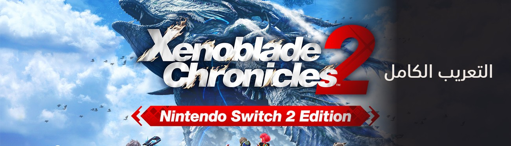

الموقع / Website: <a href="https://enmaworld.com/translations/xenoblade-chronicles-2/">enmaworld.com</a>

# Xenoblade Chronicles 2 - التعريب الكامل

تعريب كامل لـXenoblade Chronicles 2 (نسخة Nintendo Switch 2 Edition) بالعربية الفصحى، مترجم من النص الياباني الأصلي: 84,200 سطر تشمل القصة كلها وقصة Torna - The Golden Country والمهام والحوارات الجانبية والقوائم وأسماء الشخصيات والنصال والأماكن والأدوات، إلى جانب شاشات الشرح وصور القوائم وبطاقات الفصول بالعربية.

**إصدار تجريبي (1.0.0-beta):** أرسل صورة لأي نص غير مترجم أو مقصوص أو خارج مكانه في [Issues](../../issues).

## لمن هذا التعريب

للعبة على الحاسوب عبر [XC2 NS2 Recomp](https://github.com/weile10000/xc2-ns2-recomp)، المبنية من نسختك الخاصة للإصدار 3.0.1 من Nintendo Switch 2 Edition. المحتوى الإضافي (Torna) يُعرَّب أيضًا إن كان موجودًا.

## التحميل

من صفحة [الإصدارات](../../releases/latest) حمّل ملف `Xenoblade2-Arabic-v1.0.0-beta.exe`.

## التثبيت

1. أغلق اللعبة والمشغّل (xc2-launcher).
2. شغّل المثبّت، واختر مجلد XC2 NS2 Recomp، واضغط «تثبيت اللغة العربية».
3. اجعل لغة اللعبة الإنجليزية، فالعربية تحلّ محلّها، ثم شغّل اللعبة كالمعتاد.

يحتاج المثبّت إلى ‎.NET 8 Desktop Runtime‎ من Microsoft؛ إن لم يكن موجودًا يعرض Windows رابط تحميله. إن ظهرت رسالة "Windows protected your PC" اضغط More info ثم Run anyway.

للإزالة: شغّل المثبّت واضغط «إزالة اللغة العربية»، فتعود ملفات اللعبة كما كانت تمامًا.

## ما يميّز هذا التعريب

- **مترجم من اليابانية:** النص الأصلي هو المصدر، والإنجليزية مرجع مساعد فقط. الأسماء مأخوذة من اليابانية، وألقاب مثل ‑سان و‑ساما باقية.
- **نص عربي سليم داخل اللعبة:** حروف متصلة بخط SST Arabic، والأسطر بمحاذاة اليمين، والشدة والتنوين والحركات المهمة ظاهرة.
- **الصور:** شاشات الشرح والتحكم وبطاقات الفصول بالعربية.
- **مثبّت بضغطة واحدة:** يعدّل أرشيف اللعبة ويحتفظ بنسخة من الأصل، وزر الإزالة يعيده كما كان تمامًا.

## تنبيه

- صُمّم للإصدار 3.0.1 من Nintendo Switch 2 Edition فقط، ولا يعمل على نسخة Switch الأولى ولا على XC2 Recomp الخاص بها.
- يضيف التثبيت نحو 34 ميجابايت إلى ملف bf2.ard.
- أسماء صنّاع اللعبة في الختام تبقى بالإنجليزية.
- خيار التصدير إلى بطاقة microSD لجهاز Switch 2 لم يُجرَّب على جهاز حقيقي.

## شكر وتقدير

- Nintendo وMONOLITH SOFT على اللعبة. Xenoblade Chronicles 2 علامة تجارية لـNintendo، وهذا تعريب غير رسمي ومجاني يتطلب نسختك الخاصة من اللعبة ولا يحتوي على شيفرتها.
- [XC2 NS2 Recomp](https://github.com/weile10000/xc2-ns2-recomp) من weile10000، الذي يشغّل اللعبة على الحاسوب.
- SST Arabic © Monotype GmbH, used under licence.
- خط Alyamama في المثبّت مرخّص برخصة SIL Open Font License 1.1 ([Alyamama-OFL.txt](Alyamama-OFL.txt)). التفاصيل في [CREDITS.txt](CREDITS.txt).

أعجبك التعريب؟ ادعمني على Ko-fi: https://ko-fi.com/kindiboy

---

**English:** A full Modern Standard Arabic translation of Xenoblade Chronicles 2 (Nintendo Switch 2 Edition), translated from the original Japanese: 84,200 lines covering the whole story, Torna - The Golden Country, quests, side dialogue, menus and names, plus Arabic help screens and chapter cards. For [XC2 NS2 Recomp](https://github.com/weile10000/xc2-ns2-recomp) built from your own 3.0.1 dump. Download the installer from [Releases](../../releases/latest), pick the XC2 NS2 Recomp folder, click install, and keep the game language on English. Needs the Microsoft .NET 8 Desktop Runtime. SST Arabic © Monotype GmbH, used under licence.
